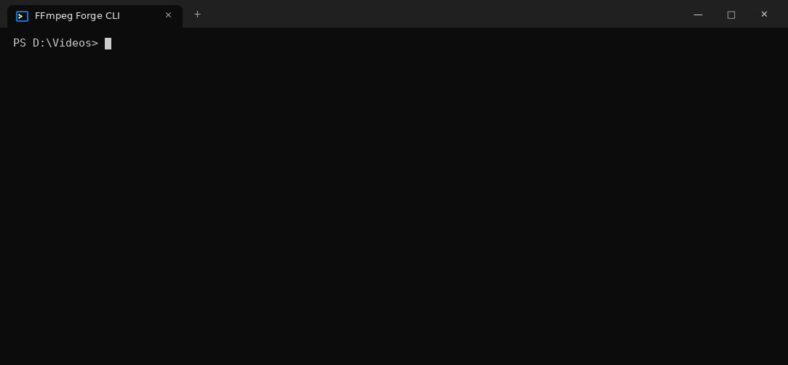

# FFmpeg Forge CLI

The conversion engine of **FFmpeg Forge 2.3.0**, on the command line. One small `forge.exe`
drives FFmpeg with the same presets, filters, upscalers, HDR, spatial audio, AI engines and
DVD / Blu-ray ripper as the FFmpeg Forge window scriptable, batchable, no GUI.



```text
forge movie.mkv -f mp4
forge convert "D:\Videos" -r -f mp4 --vcodec h265 --quality high -o "D:\Out"
forge old.avi --deinterlace double --denoise --upscale razornext --upscale-factor 2 -f mkv
forge rip E: --format mkv
```

## Features

- **Every format and codec of your FFmpeg build**: tuned presets (MP4, MKV, MOV, WebM, ProRes,
  DNxHR, MP3, FLAC, Opus, AVIF, WebP…) plus every muxer and encoder (`--vcodec enc:NAME`).
- **Video**: quality / speed presets, resolution presets (8K…480p, fit / fill / stretch), frame rate,
  rotation, trimming, subtitles, image sequences (PNG / JPG), picture → video, video → pictures.
- **Filters**: any FFmpeg filter (`--vf`, `--af`, `--filter-complex`, extra inputs).
- **Scale**: FSR 1/2/3, NIS, SGSR, Anime4K, EWA Lanczos (GPU, libplacebo / Vulkan), xBR, hqx,
  Integer, Lanczos… and the OptiScaler output stage (supersampling + RCAS).
- **Denoiser**: AI denoiser (SCUNet, HAT, DAT, SPAN) when installed, otherwise the Neat Video-style
  3D FFT denoiser with automatic noise profile.
- **Deinterlacing**: QTGMC (VapourSynth) or FFmpeg bwdif, double or same rate.
- **HDR**: SDR → HDR10 or Dolby Vision 8.1 (dynamic metadata measured on every frame, dovi_tool).
- **Audio**: up to 9.1.6 / 22.2 layouts, immersive upmix (spatial music, cinema, live), spatial
  audio for headphones, EBU R128 loudness, audio-only changes and extra audio tracks.
- **AI upscale**: RazorNext (RelayVSR, temporal video super-resolution), VisionNext (VOSR 2.0),
  SeedVR2, NVIDIA RTX Video Super Resolution / TrueHDR, your own Python / ONNX models.
- **DVD / Blu-ray ripping**: titles, playlists, chapters, audio / subtitle languages; MKV copy or
  any video / audio format; subtitles kept or burned in. Discs without copy protection only.
- **Batch friendly**: folders, wildcards, `-r`, progress bar with ETA, `--dry-run`, `--quiet`,
  exit codes, `NO_COLOR`.

## Download

Get `FFmpegForge-CLI-1.0.0-Windows.rar` from the [Releases](../../releases) page, extract it
anywhere and open a terminal in the folder (or double-click `Forge console.cmd`):

```text
forge help
forge status
```

The archive is portable: FFmpeg 9.0.2 (full build) is in `bin\`, settings stay in `Settings\`.
Without the bundled FFmpeg, forge uses `C:\FFmpeg\bin`, then the `PATH` (or `--ffmpeg PATH`).

**Requirements**: Windows 10 / 11 64-bit with .NET Framework 4.x (built into Windows).
GPU scaling needs a Vulkan driver; NVENC / RTX / AI engines need an NVIDIA GPU.
`forge.exe` also runs with Mono on Linux (use a Linux FFmpeg build).

## Usage

```text
forge <command> [options]
forge FILE|FOLDER… [convert options]
```

| Command | What it does |
| --- | --- |
| `convert` | convert videos, audio and pictures |
| `rip` | rip a DVD / Blu-ray (drive, VIDEO_TS / BDMV folder, ISO) |
| `info` | show what a file contains |
| `formats`, `codecs`, `filters` | what your FFmpeg build can do |
| `scale-types`, `denoise-presets`, `layouts` | values of `--scale`, `--denoise-preset`, `--channels` |
| `status` | FFmpeg, GPU features and AI engines found |
| `install` | install RazorNext, VisionNext, SeedVR2, QTGMC or the AI denoiser |

Full option list: [docs/USAGE.md](docs/USAGE.md) or `forge help convert` / `forge help rip`.

### Examples

```text
# H.265 MKV, high quality, 1080p maximum
forge clip.mov -f mkv --vcodec h265 --quality high --resolution 1080p

# GPU upscale x2 with FSR, sharpened, plus denoiser
forge anime.mp4 --scale fsr --scale-factor 2 --sharpness 80 --denoise

# SDR to Dolby Vision 8.1
forge trailer.mp4 -f mp4 --hdr dv --hdr-peak 1000

# 7.1.4 spatial music mix, then a stereo version for headphones
forge album.flac -t audio -f mka --channels 7.1.4 --upmix spatial
forge album.flac -t audio -f m4a --channels binaural

# add a commentary track without re-encoding the picture
forge movie.mkv -f mkv --keep-video --add-audio comment.flac:fre:Commentaire

# one frame every 5 seconds as JPEG
forge talk.mp4 -t image -f jpg --extract every:5

# rip: list titles, then titles 1 and 3 to MP4 H.265 + AAC
forge rip E: --list
forge rip E: --title 1,3 --format mp4 --video x265 --audio aac
```

### AI engines

The AI engines are optional and installed once (Windows, several GB):

```text
forge install razornext      # RelayVSR video super-resolution (native x4)
forge install visionnext     # VOSR 2.0
forge install seedvr2
forge install qtgmc
forge install ai             # AI denoiser + Python / ONNX models
```

Already installed with FFmpeg Forge (window)? Point the CLI at it instead of installing again:

```text
forge clip.mp4 --upscale razornext --forge-dir "D:\FFmpeg"
setx FFMPEG_FORGE_DIR "D:\FFmpeg"
```

### Exit codes

`0` success · `1` at least one file failed · `2` usage error · `130` cancelled (Ctrl+C)

## Build

The CLI shares its engine (`src/`) with FFmpeg Forge 2.3.0; `cli/` holds the command line.

```text
build-cli.bat                # Windows: C# compiler of .NET Framework 4, no SDK needed
./build.sh                   # Linux / macOS: Mono (mono-mcs)
```

C# 5, .NET Framework 4.0 profile, no NuGet dependencies.

## Copy protection

FFmpeg Forge does not circumvent copy protection. Discs protected by CSS, AACS or BD+ are
detected and refused: rip your own videos, home-made discs and discs without protection.

## License

GNU General Public License v3.0 — see [LICENSE](LICENSE). Embedded shaders and HRTF data:
[SHADER_LICENSES.txt](SHADER_LICENSES.txt). FFmpeg (GPL build by gyan.dev), dovi_tool (MIT),
RelayVSR / VOSR / SeedVR2 / SCUNet (Apache-2.0) keep their own licenses; AI models are
downloaded from their official repositories by the installers, they are not redistributed.
