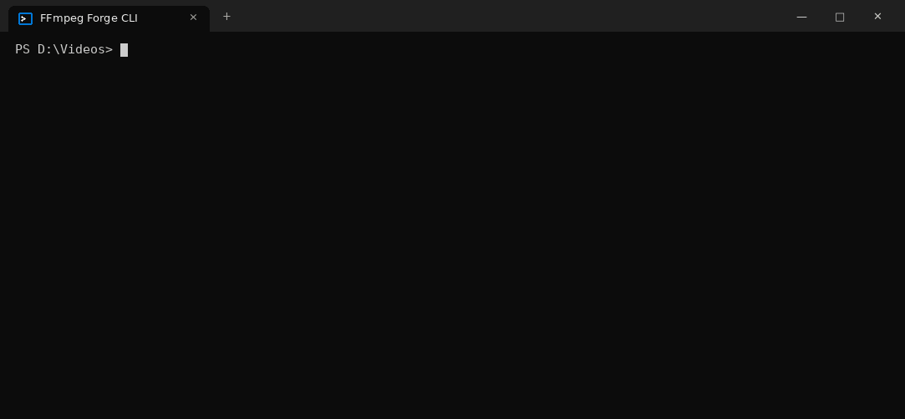

# FFmpeg Forge CLI

The conversion engine of **FFmpeg Forge 3.0.1**, on the command line. One small `forge.exe`
drives FFmpeg with the same presets, filters, upscalers, HDR, spatial audio, AI engines and
DVD / Blu-ray ripper as the FFmpeg Forge window: scriptable, batchable, no GUI. Version 2.0.0.



```text
forge movie.mkv -f mp4
forge convert "D:\Videos" -r -f mp4 --vcodec h265 --quality high -o "D:\Out"
forge old.avi --deinterlace double --denoise --upscale razornext --upscale-factor 2 -f mkv
forge clip.mp4 --upscale optipulsar --upscale-factor 4 -f mp4
forge rip E: --format mkv
```

## New in 2.0

- **Engine of FFmpeg Forge 3.0.1** (was 2.3.0): everything added since, on the command line.
- **OptiPulsar** AI upscaler (NERVE by Philip Hofmann, Apache-2.0) with a built-in engine:
  `--upscale optipulsar --upscale-factor 1|2|4|8`, installed with `forge install optipulsar`.
  No Visual Enhancer needed (`--upscale-engine ve` is still available).
- **Deblurring** with FocusPulsar: `--deblur --deblur-strength 0-200`, through an existing
  Visual Enhancer installation (`--ve-dir`).
- **LTX 2.5 Upscale** through WanGP's Video Postprocessing: `--ltx upscaler` (Pixel Spatial
  Upscaler x2) or `--ltx refiner --ltx-factor 1|1.5|2` (Detail Refiner), with `--ltx-prompt`,
  `--ltx-profile`, `--ltx-attention`, `--ltx-seed`. Installed with `forge install wangp`, or an
  existing WanGP folder with `--wangp-dir`.
- **Windows installer**: `FFmpegForge-CLI-2.0.0-Setup.exe` installs forge for the current user
  (no administrator rights), adds it to the `PATH` and creates Start menu shortcuts.
- `forge status` shows OptiPulsar, LTX 2.5 (WanGP) and Visual Enhancer; new error hints.

## Features

- **Every format and codec of your FFmpeg build**: tuned presets (MP4, MKV, MOV, WebM, ProRes,
  DNxHR, MP3, FLAC, Opus, AVIF, WebP…) plus every muxer and encoder (`--vcodec enc:NAME`).
- **Video**: quality / speed presets, resolution presets (8K…480p, fit / fill / stretch), frame rate,
  rotation, trimming, subtitles, image sequences (PNG / JPG), picture → video, video → pictures.
- **Filters**: any FFmpeg filter (`--vf`, `--af`, `--filter-complex`, extra inputs).
- **Scale**: FSR 1/2/3, NIS, SGSR, Anime4K, EWA Lanczos (GPU, libplacebo / Vulkan), xBR, hqx,
  Integer, Lanczos… and the OptiScaler output stage (supersampling + RCAS).
- **Denoiser**: AI denoiser (SCUNet, HAT, DAT, SPAN) when installed, otherwise the Neat Video-style
  3D FFT denoiser with automatic noise profile.
- **Deblurring**: FocusPulsar AI focus restoration (through Visual Enhancer).
- **Deinterlacing**: QTGMC (VapourSynth) or FFmpeg bwdif, double or same rate.
- **HDR**: SDR → HDR10 or Dolby Vision 8.1 (dynamic metadata measured on every frame, dovi_tool).
- **Audio**: up to 9.1.6 / 22.2 layouts, immersive upmix (spatial music, cinema, live), spatial
  audio for headphones, EBU R128 loudness, audio-only changes and extra audio tracks.
- **AI upscale**: RazorNext (RelayVSR, temporal video super-resolution), VisionNext (VOSR 2.0),
  OptiPulsar (NERVE), SeedVR2, LTX 2.5 Upscale (WanGP), NVIDIA RTX Video Super Resolution /
  TrueHDR, your own Python / ONNX models.
- **DVD / Blu-ray ripping**: titles, playlists, chapters, audio / subtitle languages; MKV copy or
  any video / audio format; subtitles kept or burned in. Discs without copy protection only.
- **Batch friendly**: folders, wildcards, `-r`, progress bar with ETA, `--dry-run`, `--quiet`,
  exit codes, `NO_COLOR`.

## Download

Two ways to get FFmpeg Forge CLI 2.0.0 from the [Releases](../../releases) page:

| File | What it is |
| --- | --- |
| `FFmpegForge-CLI-2.0.0-Setup.exe` | Windows installer: installs forge for the current user (no administrator rights), adds it to the `PATH`, Start menu shortcuts, uninstaller |
| `FFmpegForge-CLI-2.0.0-Windows.rar` | portable edition: extract it anywhere and open a terminal in the folder (or double-click `Forge console.cmd`) |

After the installer, open a new terminal anywhere and type:

```text
forge help
forge status
```

FFmpeg 9.0.2 (full build) is included in `bin\`. Without it, forge uses `C:\FFmpeg\bin`, then
the `PATH` (or `--ffmpeg PATH`). The installer puts forge in
`%LOCALAPPDATA%\Programs\FFmpeg Forge CLI`; the AI engines installed with `forge install` go in
the same folder.

**Requirements**: Windows 10 / 11 64-bit with .NET Framework 4.x (built into Windows).
GPU scaling needs a Vulkan driver; NVENC / RTX / AI engines need an NVIDIA GPU.
`forge.exe` also runs with Mono on Linux (use a Linux FFmpeg build).

## Usage

```text
forge <command> [options]
forge FILE|FOLDER… [convert options]
```

| Command | What it does |
| --- | --- |
| `convert` | convert videos, audio and pictures |
| `rip` | rip a DVD / Blu-ray (drive, VIDEO_TS / BDMV folder, ISO) |
| `info` | show what a file contains |
| `formats`, `codecs`, `filters` | what your FFmpeg build can do |
| `scale-types`, `denoise-presets`, `layouts` | values of `--scale`, `--denoise-preset`, `--channels` |
| `status` | FFmpeg, GPU features and AI engines found |
| `install` | install RazorNext, VisionNext, OptiPulsar, WanGP (LTX 2.5), SeedVR2, QTGMC or the AI denoiser |

Full option list: [docs/USAGE.md](docs/USAGE.md) or `forge help convert` / `forge help rip`.

### Examples

```text
# H.265 MKV, high quality, 1080p maximum
forge clip.mov -f mkv --vcodec h265 --quality high --resolution 1080p

# GPU upscale x2 with FSR, sharpened, plus denoiser
forge anime.mp4 --scale fsr --scale-factor 2 --sharpness 80 --denoise

# SDR to Dolby Vision 8.1
forge trailer.mp4 -f mp4 --hdr dv --hdr-peak 1000

# 7.1.4 spatial music mix, then a stereo version for headphones
forge album.flac -t audio -f mka --channels 7.1.4 --upmix spatial
forge album.flac -t audio -f m4a --channels binaural

# add a commentary track without re-encoding the picture
forge movie.mkv -f mkv --keep-video --add-audio comment.flac:fre:Commentaire

# one frame every 5 seconds as JPEG
forge talk.mp4 -t image -f jpg --extract every:5

# OptiPulsar x4 (built-in engine), H.265
forge clip.mp4 --upscale optipulsar --upscale-factor 4 -f mp4 --vcodec h265

# deblur with FocusPulsar (Visual Enhancer), then OptiPulsar x2
forge soft.mp4 --deblur --deblur-strength 120 --ve-dir "C:\Program Files\Visual Enhancer" --upscale optipulsar

# LTX 2.5 Detail Refiner x1.5 with a style prompt (WanGP)
forge draft.mp4 --ltx refiner --ltx-factor 1.5 --ltx-prompt "sharp detail, natural film grain"

# rip: list titles, then titles 1 and 3 to MP4 H.265 + AAC
forge rip E: --list
forge rip E: --title 1,3 --format mp4 --video x265 --audio aac
```

### AI engines

The AI engines are optional and installed once (Windows, several GB):

```text
forge install razornext      # RelayVSR video super-resolution (native x4)
forge install visionnext     # VOSR 2.0
forge install optipulsar     # NERVE upscaler, x1 x2 x4 x8 (about 3 GB with PyTorch)
forge install wangp          # WanGP for --ltx (LTX 2.5 models downloaded on the first run)
forge install seedvr2
forge install qtgmc
forge install ai             # AI denoiser + Python / ONNX models
```

Already installed with FFmpeg Forge (window)? Point the CLI at it instead of installing again:

```text
forge clip.mp4 --upscale razornext --forge-dir "D:\FFmpeg"
setx FFMPEG_FORGE_DIR "D:\FFmpeg"
```

`--deblur` (FocusPulsar) runs through an existing Visual Enhancer installation:
`--ve-dir "folder that contains VE_CLI.exe"`, with the model downloaded in Visual Enhancer
(Models tab). FFmpeg Forge writes a Visual Enhancer preset for it; a preset exported from the
Visual Enhancer app can replace it (`VE-presets\focuspulsar.json` next to forge.exe). FFmpeg
Forge does not contain or redistribute any Visual Enhancer file.

### Exit codes

`0` success · `1` at least one file failed · `2` usage error · `130` cancelled (Ctrl+C)

## Build

The CLI shares its engine (`src/`) with FFmpeg Forge 3.0.1; `cli/` holds the command line.

```text
build-cli.bat                # Windows: C# compiler of .NET Framework 4, no SDK needed
./build.sh                   # Linux / macOS: Mono (mono-mcs)
```

C# 5, .NET Framework 4.0 profile, no NuGet dependencies.

The Windows installer is built with NSIS from `installer/forge-cli.nsi`:

```text
makensis -DSRCDIR=path\to\FFmpegForge-CLI installer\forge-cli.nsi
```

## Copy protection

FFmpeg Forge does not circumvent copy protection. Discs protected by CSS, AACS or BD+ are
detected and refused: rip your own videos, home-made discs and discs without protection.

## License

GNU General Public License v3.0 — see [LICENSE](LICENSE). Embedded shaders and HRTF data:
[SHADER_LICENSES.txt](SHADER_LICENSES.txt). FFmpeg (GPL build by gyan.dev), dovi_tool (MIT),
RelayVSR / VOSR / SeedVR2 / SCUNet / NERVE (Apache-2.0), WanGP (WanGP Community License 2.0) and
the LTX-2.5 models (LTX-2 Community License) keep their own licenses; AI models are
downloaded from their official repositories by the installers, they are not redistributed.

Visual Enhancer (FocusPulsar) belongs to Merserk; FFmpeg Forge only calls an existing installation
through `VE_CLI.exe` and is not affiliated with Merserk.
